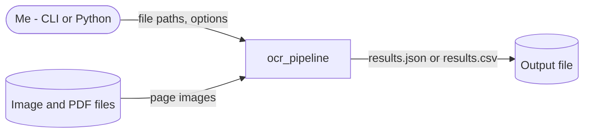
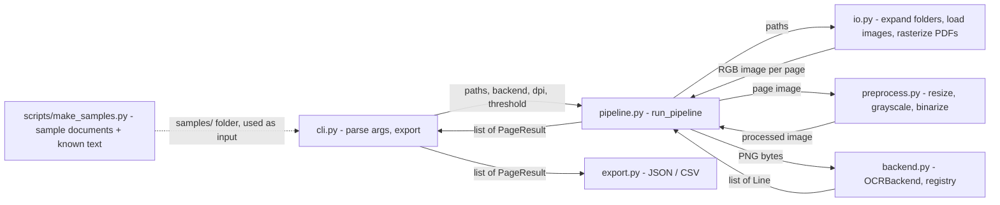

# Architecture

## Diagrams in this doc

Diagrams are written in **Mermaid** — plain text that renders as a picture
on GitHub and in VS Code (with the "Markdown Preview Mermaid Support"
extension). Being text, they live next to the docs they illustrate and
AI agents can update them in the same change as the code.

Zoom levels follow the **C4 model**: start wide, then zoom in.

| Diagram | Shows | Include |
|---|---|---|
| **System context** | The system as one box, the people who use it, and the external systems it talks to | Always |
| **Components** | The parts inside the system and the data passed between them | Always |
| **Sequence** | The order of calls/messages in one important flow | When a flow has several steps across components, or timing matters |
| **State** | The states something moves through, and what triggers each change | When something has modes (e.g. menu → playing → game over, draft → published) |
| **Data model** | Stored data: entities, fields, relationships | When the project stores data (files or database) |

Rules:
- Delete the example diagrams that don't apply — don't leave empty ones.
- Keep each diagram small: around 10 boxes at most. If it's bigger, split
  it or zoom out a level.
- Label arrows with *what* moves along them (data, call, event).
- **Diagrams must match the code.** Update them in the same change that
  alters components, interfaces, flows, states, or stored data. A wrong
  diagram is worse than none.
- Use plain words in labels — avoid `<`, `>`, and quotes inside labels;
  they can break rendering.

## Overview

A batch pipeline. `run_pipeline(paths, backend)` expands folders, turns
each input into page images, preprocesses each page, OCRs it with the given
backend, and returns one `PageResult` per page; a bad file or page becomes
an error in its result and the run goes on (skip-and-report). The CLI calls
`run_pipeline()` and writes one JSON or CSV file. No state persists between
runs. It runs fully offline: no external system is called (the Baidu API was
removed in S1.1.2).

### System context

### Components

## Components

### cli.py
Parses arguments (`inputs`, `--output`, `--format json|csv`, `--dpi`,
`--backend` (default `local`), `--threshold`), gets the backend from the
registry, calls `run_pipeline()`, exports the page results, and logs a
summary line. Exit code 0 = all pages succeeded, 1 = any page or file has an
error, 2 = usage error (no inputs, unknown or missing backend, missing path,
only empty folders) shown without a stack trace. Sets logging to INFO.
Entry point for the `ocr-pipeline` console script.

### pipeline.py
`run_pipeline(paths, backend, dpi=200, threshold=128) -> list[PageResult]`:
raises "No input
files" for an empty list, expands folders, then for each file loads its
pages and, per page, preprocesses → PNG → `backend.recognize()` → a
`PageResult` whose `text` is the lines joined with newlines. A file that
won't load gives one result with `page=None` and `error`; a page the backend
fails on gives a result with `error`. Both log a WARNING (message only;
traceback at DEBUG). `dpi` goes to PDF rasterization, `threshold` to
binarization.

### io.py
`expand_inputs(paths)` replaces each folder with its top-level image and PDF
files, sorted by name (other files and subfolders skipped at DEBUG; a
folder with nothing supported is an error if it's the only input, else a
warning; a missing path is an error). Validates paths and file types (`.jpg .jpeg .png .tiff .tif .bmp .gif`,
`.pdf`). Loads images as RGB with Pillow; rasterizes each PDF page with
PyMuPDF at the given DPI.

### preprocess.py
Resizes to fit within 2200×3200 (never upscales), converts to grayscale,
and binarizes at a fixed threshold (default 128). `deskew` is a placeholder
that returns the image unchanged.

### backend.py
Abstract `OCRBackend.recognize(image_bytes) -> list[Line]`. `BACKENDS`
is the backend registry (name → backend class); `get_backend(name)`
returns a new backend, or raises `ValueError` saying no backend is
installed, or listing the registered names. The registry is empty until
the local engine (S2.2.2); tests register a fake backend.

### models.py
Typed data passed between components: `Line` (`text`, `confidence`) and
`PageResult` (`source_file`, `page`, `text`, `lines`, `error`); `page`
is None when the whole file failed to load.

### export.py
Both take `list[PageResult]` and create the output folder if needed.
`export_to_json` writes a list of page results with every field, lines
included (UTF-8, indented; `[]` when empty). `export_to_csv` writes one row
per page with columns `source_file, page, text, confidence, error`, where
`confidence` is the mean over the page's lines (empty if none). It's
UTF-8 with a byte-order mark so Excel reads non-ASCII text; an empty list
writes the header only.

### scripts/make_samples.py
Standalone helper, not part of the package (S2.1.1). `generate_samples(out_dir)`
writes `receipt.png`, `form.png` and a 3-page `multipage.pdf` (A4 pages, each
an image drawn with Pillow) plus their known text: `receipt.txt`, `form.txt`,
`multipage_p1.txt`…`_p3.txt`. Content is fixed and fictional; PNGs carry no
timestamps and the PDF is saved with empty metadata and no new file ID, so
every run is byte-identical. `python scripts/make_samples.py` writes to
`samples/`, which is committed. The `.txt` files are skipped by
`expand_inputs`, so `ocr-pipeline samples/` sees 5 pages.

### Known gaps

- Pages are processed one at a time — no parallel inference.
- All pages of one file are loaded into memory before its OCR starts (S1.1.3
  dropped).

## Data flow contract

- **caller → pipeline:** `run_pipeline(paths: Iterable[Path], backend:
  OCRBackend, dpi: int = 200, threshold: int = 128) -> list[PageResult]`,
  one per page in input order.
- **io → pipeline:** `list[PIL.Image.Image]` per file, pages in RGB.
- **preprocess → backend:** PNG-encoded `bytes` of a grayscale, binarized
  image.
- **backend → pipeline:** `list[Line]`, in reading order.
- **cli → export:** `list[PageResult]`, one per page.

## Design options and trade-offs

Most design choices are small and easy to change later — just pick the
simplest option and move on. A choice gets a **formal comparison** when any
of these is true:

- it's hard or expensive to reverse (data format, language, storage,
  framework, an external service)
- it affects more than one component, or the interfaces between them
- there are two or more genuinely viable options and the right one isn't
  obvious

For those, the process is:

1. **List the options** — usually 2-3, always including the simplest one
   that could work.
2. **Compare them** against criteria that come from `00-vision.md` (goals,
   constraints) — e.g. simplicity, effort, performance, cost, how easy it
   is to change later, fit with skills you have.
3. **Recommend one**, with the trade-off you'd be accepting.
4. **The user decides.** Log the full comparison and the decision in
   `05-decisions-log.md` (its template has the options table).
5. **Summarise it here** in the table below, and update the design sections
   above to match.

### Open design questions

Choices that need a comparison but haven't been decided yet. Each should
also exist as a `Proposed` entry in `05-decisions-log.md`.

- Which local OCR engine: Tesseract, RapidOCR or EasyOCR? → decide in
  S2.2.1 (engine spike, Phase 2). Recorded as open in
  `05-decisions-log.md` → 2026-10-10 Next direction.
- Which UI library: Streamlit or Gradio? → decide at the start of Phase 3.
  Same decision entry.

### Key decisions

The chosen option for each significant design question — details,
rejected options and reasoning are in the linked log entry.

| Area | Chosen | Main alternative rejected | Trade-off accepted | Decision |
|---|---|---|---|---|
| Direction | Clean core + simple local UI (Option B) | Rewrite as a web app | UI library and accessibility work added | `05-decisions-log.md` → 2026-10-10 Next direction |
| Phase order / backend | Refactor first; Baidu removed; local engine next | Working pipeline first; keep Baidu | No real OCR until Phase 2 | `05-decisions-log.md` → 2026-10-10 Phase order changed |
| Formatter and linter | Ruff (format + lint) | Black + Flake8 | A younger tool | `05-decisions-log.md` → 2026-10-11 Formatter, linter and test runner |
| Coverage and audit | `pytest-cov` + `pip-audit`, phase end only | Dependabot only, no coverage | Two more dev tools | `05-decisions-log.md` → 2026-10-11 Coverage and dependency audit tools |

## Non-goals

- No hosted service, full desktop app, model training, layout reconstruction, or
  handwriting tuning in this version — see `00-vision.md` → Non-goals.
