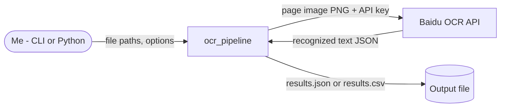
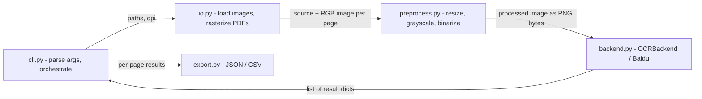

# Architecture

## Diagrams in this doc

Diagrams are written in **Mermaid** — plain text that renders as a picture
on GitHub and in VS Code (with the "Markdown Preview Mermaid Support"
extension). Being text, they live next to the docs they illustrate and
AI agents can update them in the same change as the code.

Zoom levels follow the **C4 model**: start wide, then zoom in.

| Diagram | Shows | Include |
|---|---|---|
| **System context** | The system as one box, the people who use it, and the external systems it talks to | Always |
| **Components** | The parts inside the system and the data passed between them | Always |
| **Sequence** | The order of calls/messages in one important flow | When a flow has several steps across components, or timing matters |
| **State** | The states something moves through, and what triggers each change | When something has modes (e.g. menu → playing → game over, draft → published) |
| **Data model** | Stored data: entities, fields, relationships | When the project stores data (files or database) |

Rules:
- Delete the example diagrams that don't apply — don't leave empty ones.
- Keep each diagram small: around 10 boxes at most. If it's bigger, split
  it or zoom out a level.
- Label arrows with *what* moves along them (data, call, event).
- **Diagrams must match the code.** Update them in the same change that
  alters components, interfaces, flows, states, or stored data. A wrong
  diagram is worse than none.
- Use plain words in labels — avoid `<`, `>`, and quotes inside labels;
  they can break rendering.

## Overview

A batch pipeline. One CLI run loads every input, turns each into page
images, preprocesses each page, OCRs it with the selected backend, and
writes one JSON or CSV file. No state persists between runs.

### System context

### Components

## Components

### cli.py
Parses arguments (`inputs`, `--output`, `--format json|csv`, `--dpi`,
`--backend baidu`, `--threshold`), picks the backend, and runs the loop:
load → preprocess → encode PNG → recognize → collect → export. Entry point
for the `ocr-pipeline` console script.

### io.py
Validates paths and file types (`.jpg .jpeg .png .tiff .tif .bmp .gif`,
`.pdf`). Loads images as RGB with Pillow; rasterizes each PDF page with
PyMuPDF at the given DPI. Returns a list of `(source path, image)` — PDF
pages get a synthetic `<stem>_page_<n>.png` source name.

### preprocess.py
Resizes to fit within 2200×3200 (never upscales), converts to grayscale,
and binarizes at a fixed threshold (default 128). `deskew` is a placeholder
that returns the image unchanged.

### backend.py
Abstract `OCRBackend.recognize(image_bytes) -> list[dict]`.
`BaiduUnlimitedOCRBackend` reads `BAIDU_OCR_API_KEY` and
`BAIDU_OCR_API_URL` from the environment, POSTs the PNG with a Bearer
token (60 s timeout), and returns the response's `results` list. The
request format is a guess and is not yet verified against Baidu's real API.

### export.py
`export_to_json` writes the results list as-is (UTF-8, indented).
`export_to_csv` writes one row per page with the top-level keys as columns.

### Known gaps

- Pages are processed one at a time — no parallel inference yet (the README
  mentions it).
- All pages of all inputs are loaded into memory before OCR starts.
- CSV export writes each page's nested `results` list as a single string
  column.

## Data flow contract

- **io → preprocess:** `list[tuple[Path, PIL.Image.Image]]`, images in RGB.
- **preprocess → backend:** PNG-encoded `bytes` of a grayscale, binarized
  image.
- **backend → cli:** `list[dict]` — the backend's raw result items (shape
  depends on the backend; not yet normalized).
- **cli → export:** `list[{"source": str, "results": list[dict]}]`, one
  entry per page.

## Design options and trade-offs

Most design choices are small and easy to change later — just pick the
simplest option and move on. A choice gets a **formal comparison** when any
of these is true:

- it's hard or expensive to reverse (data format, language, storage,
  framework, an external service)
- it affects more than one component, or the interfaces between them
- there are two or more genuinely viable options and the right one isn't
  obvious

For those, the process is:

1. **List the options** — usually 2-3, always including the simplest one
   that could work.
2. **Compare them** against criteria that come from `00-vision.md` (goals,
   constraints) — e.g. simplicity, effort, performance, cost, how easy it
   is to change later, fit with skills you have.
3. **Recommend one**, with the trade-off you'd be accepting.
4. **The user decides.** Log the full comparison and the decision in
   `05-decisions-log.md` (its template has the options table).
5. **Summarise it here** in the table below, and update the design sections
   above to match.

### Open design questions

Choices that need a comparison but haven't been decided yet. Each should
also exist as a `Proposed` entry in `05-decisions-log.md`.

- <question — e.g. "How should run results be stored?"> → decide by <phase
  or trigger>

### Key decisions

The chosen option for each significant design question — details,
rejected options and reasoning are in the linked log entry.

| Area | Chosen | Main alternative rejected | Trade-off accepted | Decision |
|---|---|---|---|---|
| Direction | Clean core + simple local UI (Option B) | Rewrite as a web app | UI library and accessibility work added | `05-decisions-log.md` → 2026-10-10 Next direction |
| Phase order / backend | Refactor first; Baidu removed; local engine next | Working pipeline first; keep Baidu | No real OCR until Phase 2 | `05-decisions-log.md` → 2026-10-10 Phase order changed |

## Non-goals

- No hosted service, full desktop app, model training, layout reconstruction, or
  handwriting tuning in this version — see `00-vision.md` → Non-goals.
