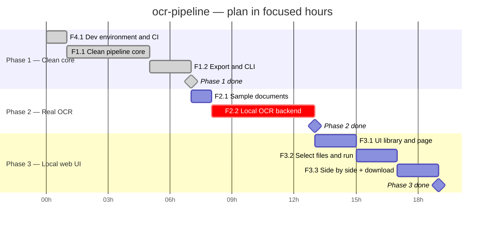

# Project plan

Turn images and multi-page PDFs into per-page text as JSON or CSV, and find
out whether the OCR is good enough on my own documents (`00-vision.md`). See `02-architecture.md` for how the phases
below map to system components.

This doc is about *when*; `01-requirements.md` is about *what*. Each phase
lists the features/stories it delivers by ID, plus any setup tasks that
aren't stories.

Each phase has a goal, a task list, and exit criteria. A phase is done when
its exit criteria are met and the "before marking a phase done" section of
`07-testing-checklist.md` passes — not when the tasks are ticked.

**Baseline (2026-10-10):** the project already exists — a Python CLI and
library that rasterizes PDFs, preprocesses images, calls a pluggable OCR
backend (Baidu), and exports JSON/CSV, with pytest tests and GitHub Actions
CI. Phase 0 is marked done for that existing scaffold; the open items below
(tests never run locally because of a pip SSL error, an unverified real
Baidu call) carry into the next planned work via `/breakdown`.

**Breakdown (2026-10-10):** refactor first, then a free local engine,
then the UI; Baidu is removed (`05-decisions-log.md` → Phase order
changed).

## Phase 0 — Environment setup
**Estimate:** done (existing code)
**Goal:** Prove the toolchain and the riskiest integration work end-to-end,
with no real logic yet.

- [ ] Choose and record the stack (`AGENTS.md` → Choosing the stack)
- [ ] Set up the environment and dependencies
- [ ] <Smallest possible end-to-end round trip through the riskiest part>
- [ ] Create the test folders (`07-testing-checklist.md` → Kinds of tests)
      and run one passing test from the test runner
- [ ] Fill in `AGENTS.md` → Commands (run, test, coverage, lint, format)
- [ ] Make the first commit on `main` (`13-git-workflow.md`)
- [ ] *GitHub only (n/a if `Hosting: local`):* create the GitHub repo, push
      `main`, and (optionally) protect `main` (`13-git-workflow.md`)
- [ ] *GitHub only (n/a if `Hosting: local`):* turn on Dependabot and
      secret scanning (`14-security.md` → GitHub setup)
- [ ] Copy `.env.example` to `.env` if the project needs secrets
- [ ] First pass of the threat model (`14-security.md`)
- [ ] Decide whether accessibility applies and trim `15-accessibility.md`
- [ ] Set budget limits and provider spend alerts (`16-budget.md`)
- [ ] Fill in the non-functional requirements (`01-requirements.md`)
- [ ] <Measure the one number that matters, if any (speed, latency, size)>

**Exit criteria:** <What you can demonstrate, reliably.>

## Phase 1 — Clean core
**Estimate:** ~8h
**Goal:** Tests green on a working environment, and one clean
`run_pipeline()` with typed results that the CLI calls.
**Delivers:** F4.1, F1.1, F1.2

- [x] S4.1.1 — Dependencies install and existing tests pass locally
- [x] S4.1.2 — CI runs on every PR
- [x] S1.1.1 — Typed page result
- [x] S1.1.2 — Backend registry; Baidu removed
- [x] S1.1.4 — Folder inputs expand to their files
- [x] S1.1.5 — `run_pipeline()` with skip-and-report
- [x] S1.2.1 — JSON and CSV from page results
- [x] S1.2.2 — CLI is a thin caller of `run_pipeline()`
- [x] Choose formatter and linter, and fill in `AGENTS.md` → Commands
      (setup task, pending entry in `05-decisions-log.md`)

**Exit criteria:** `pytest` passes locally and in CI; the CLI, with a fake
backend in tests, turns files and folders into JSON and one-row-per-page
CSV, and a corrupt file is reported without stopping the run.

## Phase 2 — Real OCR, local engine
**Estimate:** ~6h
**Goal:** Real, free, offline OCR on generated samples with known text.
**Delivers:** F2.1, F2.2

- [ ] S2.1.1 — Sample document generator
- [ ] S2.2.1 — Engine spike: Tesseract vs RapidOCR
- [ ] S2.2.2 — Local OCR backend
- [ ] S2.2.3 — Local engine as default; end-to-end on samples

**Exit criteria:** `ocr-pipeline samples/ --output r.csv` runs offline with
no flags in under 60 s, and the manual spot-check in `12-manual-tests.md`
finds the text readable.

## Phase 3 — Local web UI
**Estimate:** ~6h (stories written when the phase starts)
**Goal:** A local page to pick files and folders and judge OCR page by page.
**Delivers:** F3.1, F3.2, F3.3

- [ ] F3.1 — Pick UI library and show a page
- [ ] F3.2 — Select or drag files and folders, then run
- [ ] F3.3 — Page and text side by side, plus JSON/CSV download

**Exit criteria:** all 5 sample pages can be reviewed side by side in the
browser and downloaded as JSON/CSV; the `15-accessibility.md` pass is done.

## Phase 4 — Tuning and iteration
**Estimate:** Ongoing
**Goal:** Better text on my own documents — readable and mostly correct
when spot-checked.

- [ ] F2.3 — Tunable preprocessing

**Exit criteria:** None — this phase is iterative and ongoing.

## Status

Development turnaround is fast, so plans are in **focused hours**, not
calendar dates. Fill in the estimate when the plan is made; fill in actual
hours (summed from "Time spent" in `10-session-log.md`) and actual dates as
phases start and finish. Never overwrite the estimate — the gap between
estimate and actual is what makes estimates better next time.

| Phase | Status | Estimate (h) | Actual (h) | Actual start | Actual end |
|---|---|---|---|---|---|
| 0 — Environment setup | Done | — | — | — | 2026-10-10 (existing scaffold) |
| 1 — Clean core | Done | 8 | ~3 (incl. breakdown) | 2026-10-10 | 2026-10-11 |
| 2 — Real OCR, local engine | Not started | 6 | | | |
| 3 — Local web UI | Not started | 6 | | | |
| 4 — Tuning | Not started | Ongoing | | | |

**Statuses:** `Not started` · `In progress` · `Done` · `Blocked`

## Timeline

Gantt chart of the plan, by phase and feature. Written in Mermaid, so it
renders on GitHub and in VS Code's Markdown preview (with the "Markdown
Preview Mermaid Support" extension).

Bars are sized in **focused hours** (`2h`), chained with `after`, so the
chart shows the relative size and order of work — the axis is not a
calendar forecast.

How to maintain it:
- One `section` per phase, one bar per feature (use its ID from
  `01-requirements.md`) or setup task.
- Mark bars `done` or `active` as work progresses; add `crit` to anything
  on the critical path or running late.
- Use `after <id>` for dependencies so later bars shift automatically when
  an earlier one moves.

