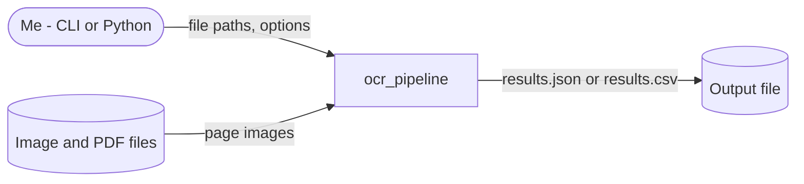
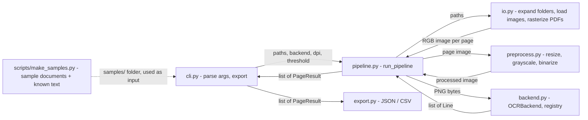

# Architecture

Diagram rules: the standard's `decisions.md` → Architecture docs and
diagrams. Diagrams must match the code: update them in the same change.


## Overview

A batch pipeline. `run_pipeline(paths, backend)` expands folders, turns
each input into page images, preprocesses each page, OCRs it with the given
backend, and returns one `PageResult` per page; a bad file or page becomes
an error in its result and the run goes on (skip-and-report). The CLI calls
`run_pipeline()` and writes one JSON or CSV file. No state persists between
runs. It runs fully offline: no external system is called (the Baidu API was
removed in S1.1.2).

### System context



### Components



## Components

### cli.py
Parses arguments (`inputs`, `--output`, `--format json|csv`, `--dpi`,
`--backend` (default `local`), `--threshold`), gets the backend from the
registry, calls `run_pipeline()`, exports the page results, and logs a
summary line. Exit code 0 = all pages succeeded, 1 = any page or file has an
error, 2 = usage error (no inputs, unknown or missing backend, missing path,
only empty folders) shown without a stack trace. Sets logging to INFO.
Entry point for the `ocr-pipeline` console script.

### pipeline.py
`run_pipeline(paths, backend, dpi=200, threshold=128) -> list[PageResult]`:
raises "No input
files" for an empty list, expands folders, then for each file loads its
pages and, per page, preprocesses → PNG → `backend.recognize()` → a
`PageResult` whose `text` is the lines joined with newlines. A file that
won't load gives one result with `page=None` and `error`; a page the backend
fails on gives a result with `error`. Both log a WARNING (message only;
traceback at DEBUG). `dpi` goes to PDF rasterization, `threshold` to
binarization.

### io.py
`expand_inputs(paths)` replaces each folder with its top-level image and PDF
files, sorted by name (other files and subfolders skipped at DEBUG; a
folder with nothing supported is an error if it's the only input, else a
warning; a missing path is an error). Validates paths and file types (`.jpg .jpeg .png .tiff .tif .bmp .gif`,
`.pdf`). Loads images as RGB with Pillow; rasterizes each PDF page with
PyMuPDF at the given DPI.

### preprocess.py
Resizes to fit within 2200×3200 (never upscales), converts to grayscale,
and binarizes at a fixed threshold (default 128). `deskew` is a placeholder
that returns the image unchanged.

### backend.py
Abstract `OCRBackend.recognize(image_bytes) -> list[Line]`. `BACKENDS`
is the backend registry (name → backend class); `get_backend(name)`
returns a new backend, or raises `ValueError` saying no backend is
installed, or listing the registered names. The registry is empty until
the local engine (S2.2.2); tests register a fake backend.

### models.py
Typed data passed between components: `Line` (`text`, `confidence`) and
`PageResult` (`source_file`, `page`, `text`, `lines`, `error`); `page`
is None when the whole file failed to load.

### export.py
Both take `list[PageResult]` and create the output folder if needed.
`export_to_json` writes a list of page results with every field, lines
included (UTF-8, indented; `[]` when empty). `export_to_csv` writes one row
per page with columns `source_file, page, text, confidence, error`, where
`confidence` is the mean over the page's lines (empty if none). It's
UTF-8 with a byte-order mark so Excel reads non-ASCII text; an empty list
writes the header only.

### scripts/make_samples.py
Standalone helper, not part of the package (S2.1.1). `generate_samples(out_dir)`
writes `receipt.png`, `form.png` and a 3-page `multipage.pdf` (A4 pages, each
an image drawn with Pillow) plus their known text: `receipt.txt`, `form.txt`,
`multipage_p1.txt`…`_p3.txt`. Content is fixed and fictional; PNGs carry no
timestamps and the PDF is saved with empty metadata and no new file ID, so
every run is byte-identical. `python scripts/make_samples.py` writes to
`samples/`, which is committed. The `.txt` files are skipped by
`expand_inputs`, so `ocr-pipeline samples/` sees 5 pages.

### Known gaps

- Pages are processed one at a time — no parallel inference.
- All pages of one file are loaded into memory before its OCR starts (S1.1.3
  dropped).

## Data flow contract

- **caller → pipeline:** `run_pipeline(paths: Iterable[Path], backend:
  OCRBackend, dpi: int = 200, threshold: int = 128) -> list[PageResult]`,
  one per page in input order.
- **io → pipeline:** `list[PIL.Image.Image]` per file, pages in RGB.
- **preprocess → backend:** PNG-encoded `bytes` of a grayscale, binarized
  image.
- **backend → pipeline:** `list[Line]`, in reading order.
- **cli → export:** `list[PageResult]`, one per page.

## Design decisions

How significant choices are made: the standard's `decisions.md`. Full
entries are in `decisions.md`.


### Open design questions

- Which local OCR engine: Tesseract, RapidOCR or EasyOCR? → decide in
  S2.2.1 (engine spike, Phase 2). Recorded as open in
  `decisions.md` → 2026-10-10 Next direction.
- Which UI library: Streamlit or Gradio? → decide at the start of Phase 3.
  Same decision entry.

### Key decisions

The chosen option for each significant design question — details,
rejected options and reasoning are in the linked log entry.

| Area | Chosen | Main alternative rejected | Trade-off accepted | Decision |
|---|---|---|---|---|
| Direction | Clean core + simple local UI (Option B) | Rewrite as a web app | UI library and accessibility work added | `decisions.md` → 2026-10-10 Next direction |
| Phase order / backend | Refactor first; Baidu removed; local engine next | Working pipeline first; keep Baidu | No real OCR until Phase 2 | `decisions.md` → 2026-10-10 Phase order changed |
| Formatter and linter | Ruff (format + lint) | Black + Flake8 | A younger tool | `decisions.md` → 2026-10-11 Formatter, linter and test runner |
| Coverage and audit | `pytest-cov` + `pip-audit`, phase end only | Dependabot only, no coverage | Two more dev tools | `decisions.md` → 2026-10-11 Coverage and dependency audit tools |

## Non-goals

- No hosted service, full desktop app, model training, layout reconstruction, or
  handwriting tuning in this version — see `requirements.md` → Non-goals.

## Tech stack

Every dependency appears here with a reason. Adding one needs a logged
decision first (the standard's `security.md` → Dependencies).

### Core

Existing stack, recorded as found in the repo (see `decisions.md` →
"Existing stack, kept as is").

| Layer | Choice | Rationale |
|---|---|---|
| Language | Python 3.11+ (`requires-python = ">=3.11"`; CI on 3.13) | Existing code |
| Packaging | setuptools via `pyproject.toml`, `src/` layout, console script `ocr-pipeline` | Existing code |
| CLI | `argparse` (standard library) | No extra dependency |
| PDF rasterization | PyMuPDF (`fitz`) ≥ 1.22 | Renders PDF pages to images at a chosen DPI |
| Image preprocessing | Pillow ≥ 10.1 | Resize, grayscale, binarize; draws the sample documents (10.1 for the bundled scalable default font) |
| OCR backend | None yet — backend registry in `backend.py` (S1.1.2); a free local engine comes in Phase 2 | Baidu removed (`decisions.md` → Phase order changed) |
| Export | `json`, `csv` (standard library) | No extra dependency |
| Persistence | None — output files only | Batch tool, no state between runs |

### Dev environment

| Tool | Purpose |
|---|---|
| Ruff | Formatting (`ruff format`, Black-compatible) and linting (`ruff check`: defaults + import sorting); config in `pyproject.toml` → `[tool.ruff]`. No type checker yet |
| pytest | Tests (`tests/`, a fake backend registered with `monkeypatch`) |
| pytest-cov | Coverage report (a hint, no target %): `pytest --cov=ocr_pipeline --cov-report=term-missing`; phase end, local only |
| pip-audit | Known vulnerabilities in the venv's installed packages (`security.md`); phase end, local only |
| venv (`.venv/`, git-ignored) | Dependency isolation |
| GitHub Actions (`.github/workflows/python.yml`) | CI: `pip install -e .`, then `pytest`, `ruff check .` and `ruff format --check .` on windows-latest, Python 3.13, on push/PR to `main` |

**Local setup (verified 2026-10-10, S4.1.1):** `python -m venv .venv` with
Python 3.13, then `pip install -e .` and `pip install pytest ruff==0.17.0 pytest-cov==7.1.0 pip-audit==2.10.1`
inside it. No
machine setting was needed: no pip config, proxy, or custom certificates.
The earlier `SSLV3_ALERT_HANDSHAKE_FAILURE` from `files.pythonhosted.org`
(`review_notes.md`) no longer reproduces, even with `--no-cache-dir`; it
was most likely a network-side issue at the time. If it comes back, check
the network/proxy and the Python version first. Never work around it with
`--trusted-host` or by turning off certificate verification.

### Starting dependencies

```
Pillow>=10.1.0
PyMuPDF>=1.22.0
```

(`requests` was removed with the Baidu backend in S1.1.2.)

Dev: `pytest` and `ruff==0.17.0` (pinned so local and CI format the same), installed separately locally and in CI; `pytest-cov==7.1.0` and `pip-audit==2.10.1`, local only for phase-end checks. None are declared in `pyproject.toml`.

### Deferred / not needed yet

- A local OCR backend — chosen in the S2.2.1 spike (Tesseract vs RapidOCR)
- OpenCV — only if `deskew` (currently a placeholder) needs it

## Words and names

Use these terms in code names, docs and replies. When a new concept comes
in, add it here in the same change. **Use instead of** lists the synonyms
ruled out: if one shows up in code or docs, rename it.

| Term | Meaning | Use instead of |
|---|---|---|
| backend | An OCR engine behind the common interface: takes one page image, returns its lines of text with confidence. | "engine" (in code), "provider", "OCR service" |
| backend registry | The name → backend lookup used by `get_backend()`; adding a backend means registering it here. | "factory", "plugin list" |
| confidence | The backend's score (0–1) for how sure it is of a line's text. In CSV, the mean over a page's lines. | "score", "probability" |
| known text | The text a sample document really contains, saved next to it as `.txt`, used to judge OCR output. | "ground truth", "expected text", "answer key" |
| line | One line of recognized text on a page, with its confidence. | "result", "item", "block" |
| page | One image sent to OCR: an image file, or one rasterized page of a PDF. Numbered from 1. | "frame", "sheet" |
| page result | The `PageResult` for one page: source file, page number, text, lines, and error (if it failed). A file that fails to load gets one page result with no page number. | "result dict", "record", "output" |
| run | One call of `run_pipeline()` (or the CLI / UI) over a set of input files and folders. | "job", "batch", "session" |
| sample document | A generated file in `samples/` with no real personal data, used to test and judge OCR. | "fixture", "test doc" |
| skip-and-report | When a file or page fails, record the error in its page result, log a warning, and keep going. | "fail-soft", "continue on error" |
| source file | The input file a page came from (image or PDF), as given by the user or found in a folder. | "input path", "origin" |
